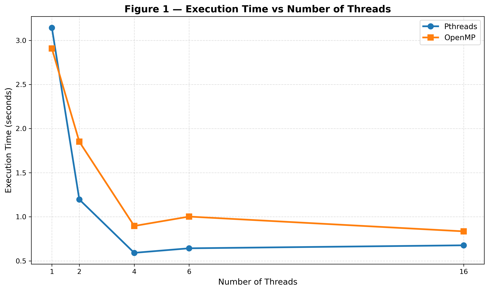
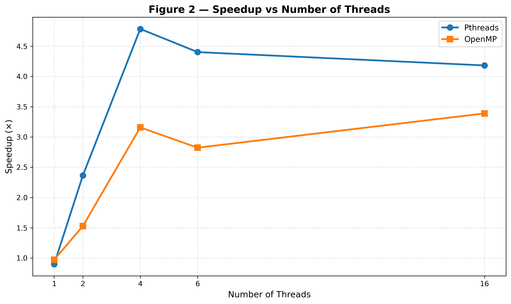
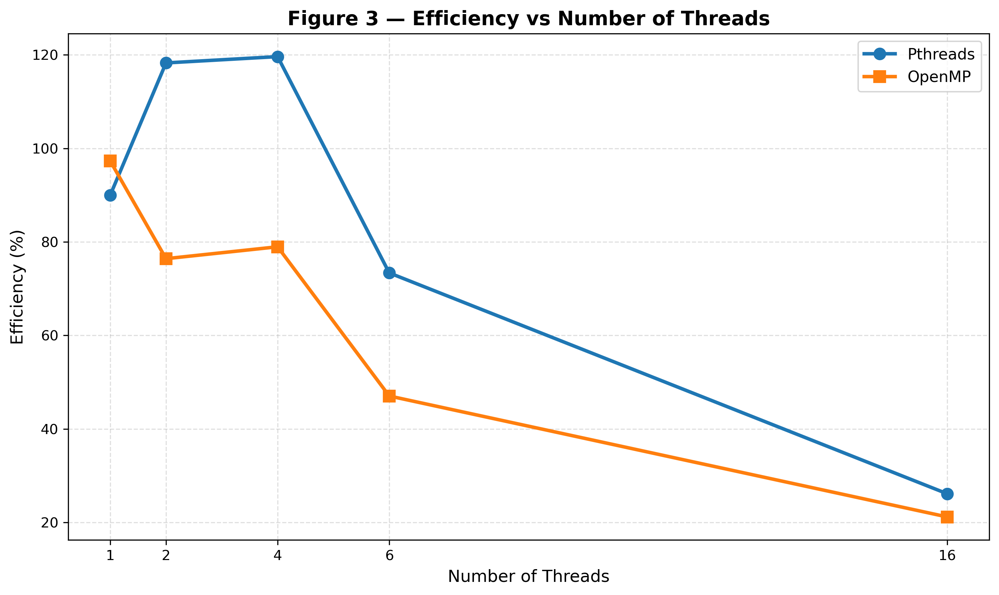
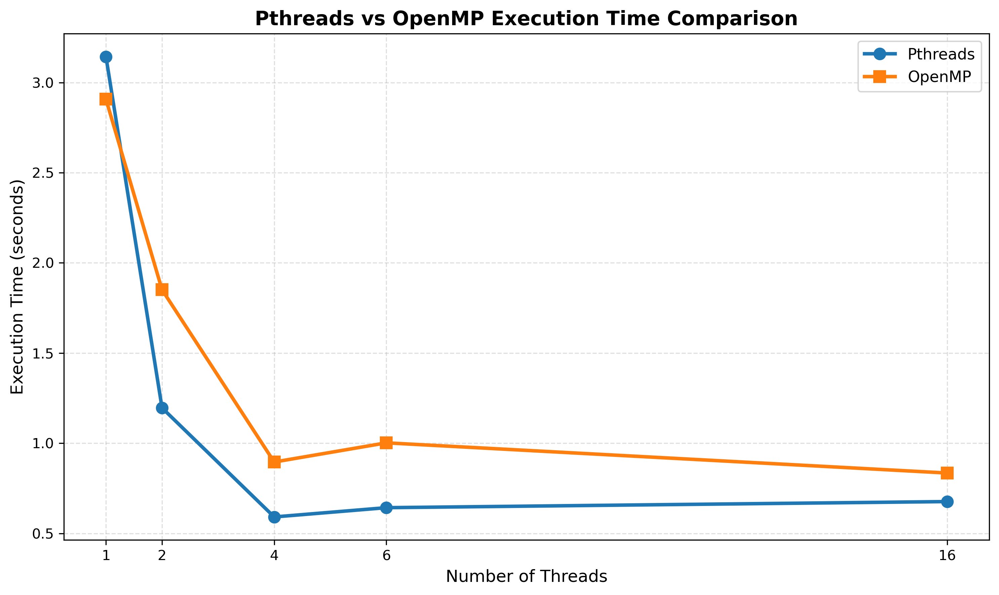

# Experiment 2 — Multithreaded Programming Using Pthreads and OpenMP

## Develop Multithreaded Programs Using Parallel Programming Libraries to Understand Thread Creation, Management, and Coordination

---

## 1. Problem Statement

Develop and execute multithreaded programs using **Pthreads** and **OpenMP** to understand thread creation, management, work distribution, race conditions, synchronization, and thread coordination. The experiment also evaluates the performance of sequential and parallel implementations by varying the number of threads and analyzing execution time, speedup, and efficiency.

---

## 2. Objectives

- To understand thread creation and management using **Pthreads**.
- To implement parallel computation and work distribution using **OpenMP**.
- To demonstrate race conditions and synchronization using mutexes and critical sections.
- To understand thread coordination using barriers.
- To compare sequential, Pthreads, and OpenMP implementations using execution time, speedup, and efficiency.

---

## 3. Basic Concept

A **thread** is an execution path within a program.

In a sequential program, a single thread performs the tasks one after another:

```text
Sequential Program

       Program
          |
          v
     Main Thread
          |
     +----+----+----+----+
     |    |    |    |    |
   Task Task Task Task ...
```

In a multithreaded program, multiple threads can work on different parts of a problem:

```text
Multithreaded Program

                 Program
                    |
          ---------------------
          |       |       |    |
       Thread 1 Thread 2 Thread 3 Thread 4
          |       |       |    |
        Work    Work    Work  Work
```

This experiment uses two parallel programming technologies:

- **Pthreads (POSIX Threads)**
- **OpenMP**

The final part measures whether increasing the number of threads reduces execution time.

---

# 4. Software Environment

### Actual Execution Environment

| Component | Configuration |
|---|---|
| Operating System | Ubuntu Linux |
| Environment | VMware Virtual Machine |
| Compiler | GCC 13.3.0 |
| Thread Library | POSIX Pthreads |
| Parallel Library | OpenMP |
| Graphing Tool | Python 3 + Matplotlib |
| Editor | Nano |

### Compiler Support

Pthreads programs were compiled using:

```bash
gcc filename.c -o output -pthread
```

OpenMP programs were compiled using:

```bash
gcc filename.c -o output -fopenmp
```

---

# Part A — Pthreads

## 5. Introduction to Pthreads

**Pthreads** stands for **POSIX Threads**.

Pthreads provides explicit control over thread creation, management, synchronization, and termination.

Important functions used in this experiment include:

```text
pthread_create()
pthread_join()
pthread_mutex_lock()
pthread_mutex_unlock()
```

### Basic Pthreads Architecture

```text
                  Main Thread
                       |
                pthread_create()
                       |
          ---------------------------
          |       |       |         |
       Thread 1 Thread 2 Thread 3 Thread 4
          |       |       |         |
          -------- Work ------------
                       |
                 pthread_join()
                       |
                 Final Result
```

---

## 6. Pthreads — Create One Thread

### Program

`src/thread1.c`

### Objective

To understand:

- Creation of a thread
- Execution of a thread function
- Waiting for a thread using `pthread_join()`

### Compile

```bash
gcc thread1.c -o thread1 -pthread
```

### Run

```bash
./thread1
```

### Actual Result

```text
Hello from the thread!
Main thread finished.
```

### Concept

The main thread already exists when the program starts.

Calling:

```c
pthread_create()
```

creates one additional thread.

The newly created thread executes the function supplied to `pthread_create()`.

The main thread uses:

```c
pthread_join()
```

to wait for the created thread to finish.

```text
pthread_create()  → CREATE
pthread_join()    → WAIT
```

---

## 7. Pthreads — Create Multiple Threads

### Program

`src/thread2.c`

Four additional threads are created using a loop.

### Compile

```bash
gcc thread2.c -o thread2 -pthread
```

### Run

```bash
./thread2
```

### Actual Result

```text
Hello from Thread 4
Hello from Thread 2
Hello from Thread 3
Hello from Thread 1
All threads have finished.
```

The order of thread messages can vary because the operating system schedules the threads independently.

The important point is that all four threads execute and `pthread_join()` ensures that the main thread waits for them to finish.

---

## 8. Pthreads — Work Distribution

### Program

`src/thread_sum.c`

The array is:

```text
10 20 30 40 50 60 70 80
```

The work is divided among four threads.

```text
Thread 1 → 10 + 20       = 30
Thread 2 → 30 + 40       = 70
Thread 3 → 50 + 60       = 110
Thread 4 → 70 + 80       = 150

Total → 30 + 70 + 110 + 150 = 360
```

### Compile

```bash
gcc thread_sum.c -o thread_sum -pthread
```

### Run

```bash
./thread_sum
```

### Actual Result

```text
Thread 4 calculated sum = 150
Thread 1 calculated sum = 30
Thread 2 calculated sum = 70
Thread 3 calculated sum = 110
Total sum = 360
```

The order of the thread messages may change, but the calculated partial sums and total remain the same.

This demonstrates **work distribution**.

---

## 9. Pthreads — Race Condition

### Program

`src/race.c`

Four threads each perform 100,000 increments on the same shared variable.

Expected value:

```text
4 × 100000 = 400000
```

### Compile

```bash
gcc race.c -o race -pthread
```

### Run

```bash
./race
```

### Actual Observations

Two runs produced:

```text
Expected counter = 400000
Actual counter   = 100411
```

and:

```text
Expected counter = 400000
Actual counter   = 133720
```

The result changes between runs because multiple threads simultaneously access and modify the same shared variable.

This is a **race condition**.

### Why does it happen?

An operation such as:

```c
counter++;
```

involves reading the current value, modifying it, and writing the result.

Two threads can access the same value before one thread's update has been completely reflected, causing a lost update.

---

## 10. Pthreads — Synchronization Using Mutex

### Program

`src/mutex.c`

A **mutex** is used to protect the shared counter.

### Compile

```bash
gcc mutex.c -o mutex -pthread
```

### Run

```bash
./mutex
```

### Actual Result

```text
Expected counter = 400000
Actual counter   = 400000
```

The shared operation is protected using:

```c
pthread_mutex_lock(&mutex);

counter++;

pthread_mutex_unlock(&mutex);
```

Conceptually:

```text
Thread 1 → LOCK → counter++ → UNLOCK
Thread 2 → LOCK → counter++ → UNLOCK
Thread 3 → LOCK → counter++ → UNLOCK
Thread 4 → LOCK → counter++ → UNLOCK
```

Only one thread can execute the protected critical section at a time.

---

# Part B — OpenMP

## 11. Introduction to OpenMP

OpenMP provides a higher-level approach to parallel programming using compiler directives.

Important directives used in this experiment include:

```c
#pragma omp parallel
#pragma omp parallel for
#pragma omp critical
#pragma omp barrier
```

OpenMP also provides mechanisms such as:

```c
reduction()
```

for combining partial results.

### OpenMP Architecture

```text
                 OpenMP Program
                       |
              #pragma omp parallel
                       |
          ---------------------------
          |       |       |         |
       Thread 0 Thread 1 Thread 2 Thread 3
          |       |       |         |
          -------- Parallel Work ---
                       |
                 Synchronization
```

---

## 12. OpenMP — Basic Parallel Region

### Program

`src/omp1.c`

### Compile

```bash
gcc omp1.c -o omp1 -fopenmp
```

### Run

```bash
./omp1
```

### Actual Result

```text
Hello from Thread 1 of 4
Hello from Thread 3 of 4
Hello from Thread 0 of 4
Hello from Thread 2 of 4
```

The program identifies:

- The current thread using `omp_get_thread_num()`
- The total number of threads using `omp_get_num_threads()`

The order of the messages may vary.

---

## 13. OpenMP — Work Sharing and Reduction

### Program

`src/omp_sum.c`

The same array used in the Pthreads work-distribution experiment is processed using OpenMP.

### Compile

```bash
gcc omp_sum.c -o omp_sum -fopenmp
```

### Run

```bash
./omp_sum
```

### Actual Result

```text
Thread 0 processing array[0] = 10
Thread 0 processing array[1] = 20
Thread 2 processing array[4] = 50
Thread 2 processing array[5] = 60
Thread 3 processing array[6] = 70
Thread 3 processing array[7] = 80
Thread 1 processing array[2] = 30
Thread 1 processing array[3] = 40
Total sum = 360
```

The directive:

```c
#pragma omp parallel for reduction(+:total_sum)
```

allows OpenMP to distribute loop iterations among threads and safely combine the partial results.

---

## 14. OpenMP — Race Condition

### Program

`src/omp_race.c`

### Compile

```bash
gcc omp_race.c -o omp_race -fopenmp
```

### Run

```bash
./omp_race
```

### Actual Result

```text
Expected counter = 400000
Actual counter   = 130571
```

This demonstrates that OpenMP does not automatically make every shared-data operation safe.

Multiple threads still modify the shared variable:

```c
counter++;
```

Therefore, a race condition can occur.

---

## 15. OpenMP — Critical Section

### Program

`src/omp_critical.c`

The race condition is fixed using:

```c
#pragma omp critical
```

### Compile

```bash
gcc omp_critical.c -o omp_critical -fopenmp
```

### Run

```bash
./omp_critical
```

### Actual Result

```text
Expected counter = 400000
Actual counter   = 400000
```

A critical section restricts execution so that only one OpenMP thread executes the protected section at a time.

---

## 16. OpenMP — Barrier

### Program

`src/omp_barrier.c`

A barrier is a synchronization point where threads wait until all threads reach the barrier.

### Compile

```bash
gcc omp_barrier.c -o omp_barrier -fopenmp
```

### Run

```bash
./omp_barrier
```

### Actual Result

```text
Thread 3 completed Stage 1
Thread 0 completed Stage 1
Thread 1 completed Stage 1
Thread 2 completed Stage 1
Thread 1 started Stage 2
Thread 3 started Stage 2
Thread 0 started Stage 2
Thread 2 started Stage 2
```

The ordering of threads can vary, but all **Stage 1** messages occur before the **Stage 2** messages.

This demonstrates thread coordination using:

```c
#pragma omp barrier
```

---

# Part C — Performance Analysis

## 17. Performance Objective

After demonstrating thread creation, work distribution, race conditions, synchronization, and coordination, the performance experiment evaluates whether increasing the number of threads reduces execution time.

The same computational workload is executed using:

1. Sequential execution
2. Pthreads
3. OpenMP

The tested thread counts are:

```text
1, 2, 4, 6, 16
```

---

## 18. Sequential Baseline

### Program

`src/sequential.c`

### Compile

```bash
gcc sequential.c -o sequential
```

### Run

```bash
./sequential
```

### Actual Result

```text
Result = 499999999500.00
Execution time = 2.829201 seconds
```

The measured sequential execution time of:

**2.829201 seconds**

is used as the baseline for calculating speedup and efficiency.

---

## 19. Pthreads Performance

### Program

`src/pthread_perf.c`

### Compile

```bash
gcc pthread_perf.c -o pthread_perf -pthread
```

### Measured Results

| Threads | Execution Time |
|---:|---:|
| 1 | 3.143891 s |
| 2 | 1.195939 s |
| 4 | **0.591231 s** |
| 6 | 0.642620 s |
| 16 | 0.676475 s |

All runs produced:

```text
Result = 499999999500.00
```

The best measured Pthreads execution time was **0.591231 seconds using 4 threads**.

---

## 20. OpenMP Performance

### Program

`src/omp_perf.c`

### Compile

```bash
gcc omp_perf.c -o omp_perf -fopenmp
```

### Measured Results

| Threads | Execution Time |
|---:|---:|
| 1 | 2.907441 s |
| 2 | 1.851130 s |
| 4 | 0.895781 s |
| 6 | 1.002151 s |
| 16 | **0.834775 s** |

All runs produced:

```text
Result = 499999999500.00
```

The best measured OpenMP execution time was **0.834775 seconds using 16 threads**.

---

# 21. Final Performance Comparison

The following results are calculated using the measured sequential baseline of **2.829201 seconds**.

### Formulas

**Speedup**

```text
Speedup = Sequential Time / Parallel Time
```

**Efficiency**

```text
Efficiency = (Speedup / Number of Threads) × 100
```

### Comparison Table

| Threads | Pthreads Time (s) | OpenMP Time (s) | Pthreads Speedup | OpenMP Speedup | Pthreads Efficiency | OpenMP Efficiency |
|---:|---:|---:|---:|---:|---:|---:|
| 1 | 3.143891 | 2.907441 | 0.900× | 0.973× | 89.99% | 97.31% |
| 2 | 1.195939 | 1.851130 | 2.366× | 1.528× | 118.28% | 76.42% |
| 4 | **0.591231** | 0.895781 | **4.785×** | 3.158× | 119.63% | 78.96% |
| 6 | 0.642620 | 1.002151 | 4.403× | 2.823× | 73.38% | 47.05% |
| 16 | 0.676475 | **0.834775** | 4.182× | **3.389×** | 26.14% | 21.18% |

> **Note:** The efficiencies above 100% at 2 and 4 Pthreads result from comparing the parallel measurements against the measured sequential baseline. They are retained as calculated from the actual benchmark data and should not be interpreted as physical processor efficiency above 100%.

---

# 22. Performance Findings

### Best Pthreads Configuration

```text
Threads          : 4
Execution Time   : 0.591231 s
Speedup          : 4.785×
```

### Best OpenMP Configuration

```text
Threads          : 16
Execution Time   : 0.834775 s
Speedup          : 3.389×
```

### Overall Findings

- The measured sequential baseline was **2.829201 seconds**.
- Pthreads achieved its lowest measured execution time at **4 threads**.
- OpenMP achieved its lowest measured execution time at **16 threads**.
- Pthreads was faster than OpenMP at 2, 4, 6, and 16 threads in this benchmark.
- OpenMP was slightly faster at 1 thread.
- Increasing the number of threads did not always decrease execution time.
- Pthreads performance worsened after the 4-thread configuration in this experiment.
- OpenMP achieved its best measured time at 16 threads.
- The results demonstrate that parallel performance depends on the workload and execution environment.

---

# 23. Why Does Increasing Threads Not Give Linear Speedup?

It may be expected that increasing the number of threads will produce proportional performance improvement.

However, real parallel programs have overhead.

Factors that can limit speedup include:

- Thread management
- Scheduling
- Synchronization
- Memory access
- Operating-system activity
- Non-parallel portions of the program

Therefore:

```text
More threads
     ↓
Potentially lower execution time
     ↓
But not necessarily proportional speedup
```

The measured results demonstrate this effect clearly.

---

# 24. Graphical Analysis

The experiment includes four graphs.

### Figure 1 — Execution Time vs Number of Threads



This graph compares Pthreads and OpenMP execution time for 1, 2, 4, 6, and 16 threads.

---

### Figure 2 — Speedup vs Number of Threads



This graph shows the speedup obtained relative to the measured sequential baseline.

---

### Figure 3 — Efficiency vs Number of Threads



This graph shows how effectively the available threads contribute to the measured speedup.

---

### Figure 4 — Pthreads vs OpenMP Execution Time



This additional comparison directly shows the measured execution-time difference between Pthreads and OpenMP.

---

# 25. Pthreads vs OpenMP — Conceptual Comparison

| Feature | Pthreads | OpenMP |
|---|---|---|
| Programming model | Explicit thread programming | Directive-based parallel programming |
| Thread creation | `pthread_create()` | OpenMP runtime |
| Waiting / completion | `pthread_join()` | Runtime handles completion at the end of a parallel region |
| Work distribution | Programmer controlled | Runtime/directives can distribute work |
| Shared-data protection | Mutex | `critical` |
| Coordination | Join and synchronization mechanisms | `barrier` |
| Combining partial results | Programmer managed | `reduction` |
| Programming complexity | More manual control | Higher-level and simpler for many parallel loops |

Pthreads provides more explicit control over individual threads, while OpenMP provides a higher-level model using compiler directives and runtime support.

---

# 26. Important Terms

### Thread

A path of execution inside a program.

### Main Thread

The thread that begins execution of the `main()` function.

### Additional Thread

A new thread created by the program.

### Multithreading

Using multiple threads within a single program.

### Parallel Programming

Dividing work so that multiple execution units can perform parts of the work concurrently.

### Work Distribution

Dividing a large task into smaller tasks and assigning them to different threads.

### Race Condition

A condition in which multiple threads access or modify shared data without proper coordination, potentially producing an incorrect result.

### Mutex

A locking mechanism used in Pthreads to protect a critical section.

### Critical Section

A section of code where simultaneous execution by multiple threads must be restricted.

### Barrier

A synchronization point where threads wait until all required threads reach the same point.

### Speedup

The improvement in execution time of a parallel implementation relative to the sequential baseline.

### Efficiency

A measure calculated from speedup and the number of threads to evaluate how effectively the available threads contribute to the measured speedup.

---

# 27. Implemented Programs

## Part A — Pthreads

| Program | Purpose |
|---|---|
| `thread1.c` | Create one thread |
| `thread2.c` | Create multiple threads |
| `thread_sum.c` | Divide work among threads |
| `race.c` | Demonstrate a race condition |
| `mutex.c` | Fix the race condition using a mutex |
| `pthread_perf.c` | Measure Pthreads performance |

## Part B — OpenMP

| Program | Purpose |
|---|---|
| `omp1.c` | Parallel region and thread identification |
| `omp_sum.c` | Work sharing and reduction |
| `omp_race.c` | Demonstrate a race condition |
| `omp_critical.c` | Synchronization using a critical section |
| `omp_barrier.c` | Thread coordination |
| `omp_perf.c` | Measure OpenMP performance |

## Part C — Performance Analysis

| Program / Activity | Purpose |
|---|---|
| `sequential.c` | Sequential baseline |
| `pthread_perf.c` | Pthreads execution-time measurement |
| `omp_perf.c` | OpenMP execution-time measurement |
| Execution-time analysis | Compare execution times |
| Speedup calculation | Measure performance improvement |
| Efficiency calculation | Evaluate thread utilization |
| Graphical analysis | Visualize measured results |

---

# 28. Complete Learning Flow

```text
START
  |
  v
Understand Threads
  |
  v
Create One Thread
  |
  v
Create Multiple Threads
  |
  v
Divide Work
  |
  v
Shared Data
  |
  v
Race Condition
  |
  v
Synchronization
  |
  v
OpenMP Parallel Region
  |
  v
OpenMP Work Sharing
  |
  v
OpenMP Race Condition
  |
  v
OpenMP Critical Section
  |
  v
OpenMP Barrier
  |
  v
Sequential Performance
  |
  v
Pthreads Performance
  |
  v
OpenMP Performance
  |
  v
Execution-Time Comparison
  |
  v
Speedup
  |
  v
Efficiency
  |
  v
Graphs
  |
  v
Final Analysis
```

---

# 29. Evidence and Results

The repository contains:

- Source code for all implemented programs
- Exact execution commands and terminal outputs
- Performance data in CSV format
- Performance analysis
- Generated graphs
- Terminal screenshots as execution evidence

### Results Files

```text
results/
├── execution_log.txt
├── performance_results.csv
└── analysis.md
```

### Graphs

```text
graphs/
├── execution_time.png
├── speedup.png
├── efficiency.png
└── pthread_vs_openmp.png
```

### Screenshots

```text
screenshots/
├── 01_thread1.png
├── 02_thread2.png
├── 03_thread_sum.png
├── 04_race.png
├── 05_mutex.png
├── 06_omp1.png
├── 07_omp_sum.png
├── 08_omp_race.png
├── 09_omp_critical.png
├── 10_omp_barrier.png
├── 11_sequential.png
├── 12_pthread_perf.png
└── 13_omp_perf.png
```

---

# 30. Repository Structure

```text
PGC-Lab-Experiment-2/
│
├── README.md
│
├── src/
│   ├── thread1.c
│   ├── thread2.c
│   ├── thread_sum.c
│   ├── race.c
│   ├── mutex.c
│   ├── omp1.c
│   ├── omp_sum.c
│   ├── omp_race.c
│   ├── omp_critical.c
│   ├── omp_barrier.c
│   ├── sequential.c
│   ├── pthread_perf.c
│   └── omp_perf.c
│
├── results/
│   ├── execution_log.txt
│   ├── performance_results.csv
│   └── analysis.md
│
├── screenshots/
│   ├── 01_thread1.png
│   ├── 02_thread2.png
│   ├── 03_thread_sum.png
│   ├── 04_race.png
│   ├── 05_mutex.png
│   ├── 06_omp1.png
│   ├── 07_omp_sum.png
│   ├── 08_omp_race.png
│   ├── 09_omp_critical.png
│   ├── 10_omp_barrier.png
│   ├── 11_sequential.png
│   ├── 12_pthread_perf.png
│   └── 13_omp_perf.png
│
├── graphs/
│   ├── execution_time.png
│   ├── speedup.png
│   ├── efficiency.png
│   └── pthread_vs_openmp.png
│
├── report/
│   └── experiment_report.md
│
└── presentation/
    └── README.md
```

---

# 31. Conclusion

This experiment demonstrated the development of multithreaded programs using **Pthreads** and **OpenMP**.

Pthreads provided explicit control over thread creation, joining, work distribution, and mutex-based synchronization. OpenMP provided a higher-level parallel programming model using parallel regions, work sharing, critical sections, barriers, and reductions.

The experiments demonstrated that multiple threads can introduce race conditions when shared data is not properly protected. The Pthreads race condition was corrected using a mutex, while the OpenMP race condition was corrected using a critical section.

The performance experiment compared sequential, Pthreads, and OpenMP implementations using different thread counts. The measured sequential baseline was **2.829201 seconds**. Pthreads achieved its best measured execution time of **0.591231 seconds with 4 threads**, while OpenMP achieved its best measured execution time of **0.834775 seconds with 16 threads**.

The performance results also demonstrate that increasing the number of threads does not automatically provide proportional speedup. Thread management, scheduling, synchronization, memory access, operating-system activity, and non-parallel work can introduce overhead.

Overall, the experiment demonstrates the complete parallel-programming workflow:

```text
Create
  ↓
Manage
  ↓
Divide Work
  ↓
Share Data
  ↓
Handle Race Conditions
  ↓
Synchronize
  ↓
Coordinate
  ↓
Measure Performance
  ↓
Analyze Results
```

The experiment therefore provides practical understanding of **thread creation, management, work distribution, synchronization, coordination, performance measurement, speedup, and efficiency** using Pthreads and OpenMP.

---

## Author

**Zakiya Tahasildar**

KLE Technological University  
B.Tech — Computer Science and Artificial Intelligence

---

## Related Repository

PGC Lab Repository:

`https://github.com/Zakiya-t/PGC-Lab`
